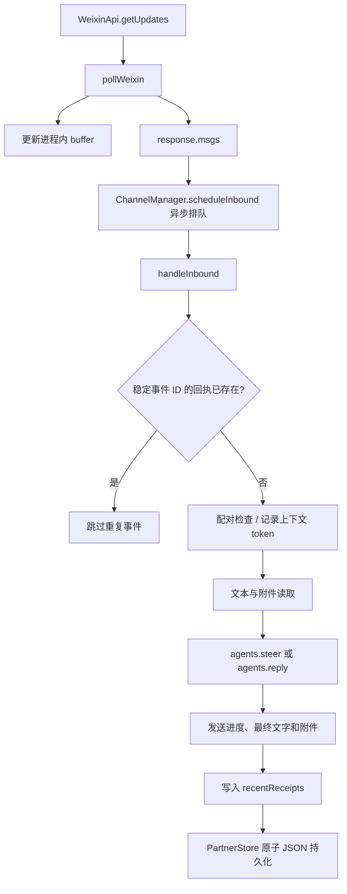

# Phase 0 基线核对与问题复现

日期：2026-11-04  
源码仓库：`D:\yliyun_project\dsh-partner`  
规格依据：`spec/DSH-Partner-Mattermost-WeChat-Codex-Refactor-SPEC.md` §15  
本报告记录基线，不包含核心实现改动。

## 结论

P0-01 至 P0-07 的调查记录已汇总。P0-06 的微信游标重启与重复消息模拟已完成，结果显示：已写入持久化回执的消息可去重；若 Agent 已执行而发送结果不确定、回执尚未写入，重启重放会再次执行 Agent。模拟中未观察到消息丢失，但微信服务端收到空游标后的实际重放规则仍未通过真实账号验证。

Phase 0 适合提交审核，不等于当前基线无问题：完整测试基线有 30 项失败；Mattermost 现状测试只覆盖 DM，频道提及和 thread 仍未验证；Codex App Server 未执行真实推理轮次。按 Plane 工作项约定，Phase 0 保持 In Progress，待用户审核报告后再进入 Phase 1；目前不切换迭代分支。

## Git 与版本基线

| 项目 | 观察结果 |
| --- | --- |
| 分支 / 提交 | `main` / `e5c1612a8852b3472ecf7067606842faa63efea9` |
| 工作区 | 已跟踪文件干净；已有未跟踪 `spec/`（用户提供的规格），保留未改动 |
| 源码包 | `package.json` 与 `package-lock.json` 均为 `2.23.55` |
| 当前 Node / npm | Node `v24.20.0`，npm `11.19.0` |
| 声明的宿主范围 | `engines.dsh: ^0.2.1-rc.2`；Node `^22.19.0 || >=24.0.0` |
| 主要 peer 范围 | DSH agent/session 等 `^0.2.1-rc.2`；Cordis `^4.0.5` |
| P0-07 检查的 yly-dev 安装 | 已安装插件 `2.25.3`、DSH `0.2.1-rc.5`、subagent 插件 `0.2.1-rc.5`；这与当前源码检出 `2.23.55` 不是同一版本 |
| P0-07 检查的 Codex CLI | `0.166.0` |

宿主 peer 范围声明只能说明依赖解析范围，不单独证明每个版本组合的运行兼容性。P0-07 的 App Server 初始化和模型列表成功，也不代表已验证推理或工具委派。

## 当前消息处理架构

关键实现位置：

- `src/channels/weixin/poll.ts`：`buffer` 是 `pollWeixin` 内的局部变量；同一进程内按响应推进，函数重建时初始化为空字符串。
- `src/channels/manager.ts`：`pollLoop` 将消息交给异步 `scheduleInbound`；`handleInbound` 以 `channelId + message_id/msg_id/seq` 检查 `recentReceipts`，审批后再调用 Agent。
- `src/channels/manager.ts`：WeChat `context_token` 保存在进程内 `contextTokens`，不是随轮询游标一起持久化。
- `src/store.ts`：状态通过临时文件、同步写入和重命名持久化；最近回执最多保留 800 条。
- 普通文本消息的回执在 Agent 返回并完成发送尝试后写入。若进程在 Agent 已执行、发送结果不确定且回执尚未写入时中断，重放不能识别此前工作已执行。

## P0 验收记录

| 项目 | 状态 | 证据与结果 |
| --- | --- | --- |
| P0-01 Git 状态 | PASS | `git status --short --branch` 显示 `main`，仅有用户提供的未跟踪 `spec/`；HEAD 已记录，未清理或覆盖该文件。 |
| P0-02 版本核对 | PASS | 检查 `package.json`、`package-lock.json`、Node/npm 和 yly-dev 安装，版本矩阵见上表。源码版本与活动 Profile 插件版本不同。 |
| P0-03 代码定位 | PASS | 已追踪微信 poll、消息分派、授权/配对、Agent、发送、回执与 store 的调用链，并标记游标和 context token 的内存边界。 |
| P0-04 自动化基线 | FAIL（既有失败） | `npm test` 的构建阶段通过；Node 测试总计 1308，1278 通过、30 失败、0 取消/跳过，退出码 1。失败类别包括 Windows 符号链接 `EPERM`、POSIX 路径假设、`/proc/self/fd` 和端口 9009 占用。此处记录为本次迭代的起始基线，不将失败归因于本次改动。 |
| P0-05 Mattermost 现状 | PARTIAL | 关联测试共 48 项，47 通过、1 项因 Windows 下 Matrix 附件符号链接 `EPERM` 失败；Mattermost 模拟测试通过。现有 `test/direct-channels.test.mjs` 明确只接受双人 DM，并跳过初始化历史和 thread 帖子；频道 @提及、thread 上下文/回复没有得到验证，也未连接真实 Mattermost。 |
| P0-06 微信续读与重复 | PASS（复现完成；发现风险） | 见下节：进程内游标推进、重启归零、已提交回执去重、回执提交前中断后重放再次执行均已通过受控模拟复现。 |
| P0-07 Codex 委派 | PASS（诊断记录；端到端未验证） | Plane 记录的检查显示：Codex CLI 登录后只读 ephemeral 请求成功并返回版本信息；App Server initialize 与 8 个模型列表成功，但未执行推理轮次。yli-dev 有 `subagent_codex` 配置及 subagent 插件；`partner_work_execute` 走 DSH `ctx.agents.create`，没有插件内 Codex 执行/委派路径。因此未将其表述为“Codex 委派已成功”。 |

## P0-06 复现细节

复现使用临时状态目录、受控 `getUpdates` 响应和真实 `pollWeixin`、`PartnerStore`、`ChannelManager.handleInbound` 代码；没有连接微信账号，也没有修改源码。

1. 同一轮询实例连续请求得到游标参数 `""`、`"cursor-1"`；创建新轮询实例后再次得到 `""`。结论：游标没有跨进程恢复。
2. 服务器模拟在重启后再次返回同一个事件 ID。首轮成功并持久化回执后，重新打开 store 并再次投递同一事件：Agent 执行 1 次、外发 1 条，第二次投递被回执过滤，没有丢失或重复。
3. 对另一条消息，让 Agent 正常返回，再让 `sendText` 抛出模拟的发送确认错误。此时 store 中没有该消息回执。重新打开 store 并重放同一事件后，Agent 对该事件累计执行 2 次，第二次成功后才写入回执。结论：发送结果未知窗口会重复执行 Agent；若 Agent 做了不可逆外部操作，可能造成重复副作用。
4. 这是控制条件下的插件行为验证，不代表微信服务器必然按相同策略重放。空游标对应的真实服务端语义，以及“远端已送达但确认丢失”的实际发生方式，需要后续真实微信验收或服务端协议证据。

验证命令及结果：

- `node --test test/weixin-reconnect.test.mjs`：6/6 通过，0 失败。
- 在仓库目录运行临时 `node --input-type=module` harness，断言轮询请求序列为 `"" → "cursor-1" → ""`，并检查持久化回执与不确定发送场景；退出码 0。
- 完整既有基线：`npm test`，构建通过，测试 1278/1308 通过，30 失败，退出码 1。

## 风险与下一道门

1. **游标不持久化**：进程重启会从空字符串续读；丢失还是重放取决于微信服务端行为，本次模拟不能确认真实协议结果。
2. **Agent 执行与回执写入不原子**：发送确认不确定时重启可能重复运行 Agent。需要在后续架构/Inbox 设计阶段明确接收账本、执行状态和不确定发送的恢复策略。
3. **测试环境基线不全绿**：30 个既有失败会影响后续回归归因；进入实现前应把环境性失败与功能失败分开。
4. **Mattermost 范围缺口**：当前 DM 模拟不覆盖频道提及和 thread 路由；需要后续按 SPEC 设计补足模拟服务和真实浏览器验收。
5. **版本校准**：当前活动 Profile 的插件比源码检出新两个小版本，不能把该 Profile 的行为直接当作当前 `main` 的代码验证。
6. **Phase gate**：请先审核本报告和 P0 记录；收到审核通过后再切换到 `yly-mm-wx-up`，开始 Phase 1。此报告之前没有进行 Phase 1 或核心代码修改。
