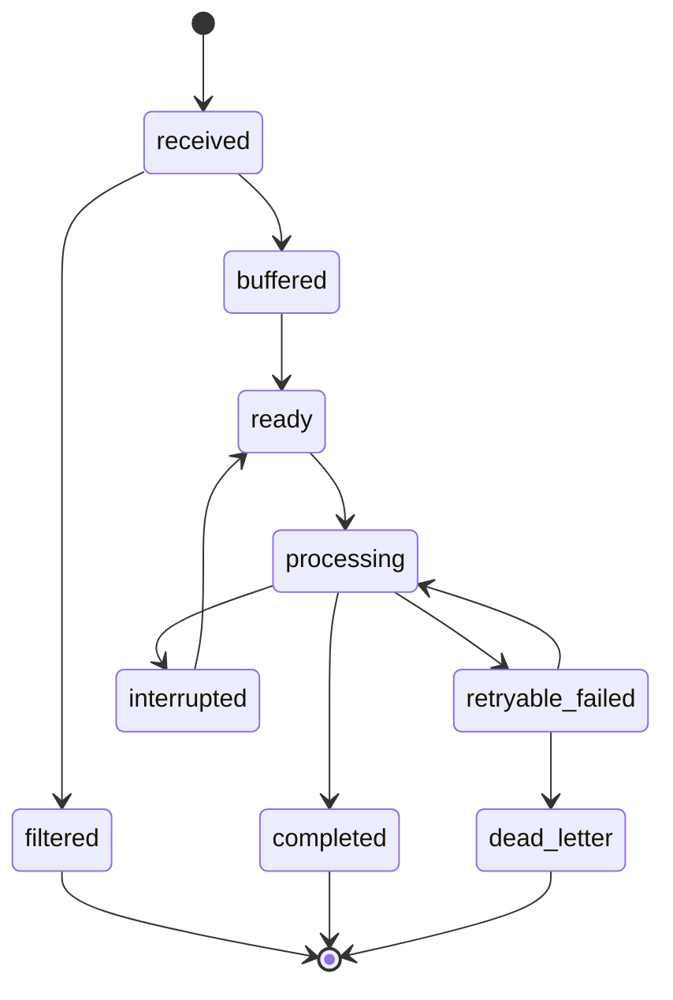

# Phase 1 — 架构设计与核心数据模型

版本标记：`2.24.1-yly-mm-wx-up.1`；包版本：`2.24.1`；分支：`yly-mm-wx-up`。

本文对应 SPEC §3、§4、§5、§9、§10 与 §15 Phase 1。它定义后续 Inbox / Session Router 使用的数据边界；本阶段不接入 Mattermost 或微信收件、Agent 执行、批次调度及实际回复流程。

## 决定与边界

- `InboundEnvelope` 是渠道事件的规范形状。渠道事件 ID、消息 ID、会话 ID、actor ID 和 Thread root 都保留为不同字段；附件只保留平台附件 ID 和文件元数据，不把文件正文、签名 URL 或凭据塞入事件。
- `replyContextToken` 是微信回复路由数据，只允许由渠道 Adapter 与回复 Adapter 消费。持久化序列化会保留它以支持恢复；它不得进入 Agent prompt、日志或错误详情。模型输入格式在后续阶段单独构建。
- `ConversationKey` 用 `ck:v1:` 和 URL 编码的稳定 ID 元组构成，字段依次为平台、账号、渠道配置、会话类型、外部会话 ID；Thread 追加 root ID。显示名、actor 显示名和消息正文不参与计算。不同账号、渠道配置或 Thread 得到不同 Key。
- 微信 `conversationId` 使用联系人稳定 ID；Mattermost DM 使用 DM channel ID；channel 使用 channel ID；thread 使用 channel ID 加 root ID。Mattermost 发送目标总是 DM channel + 经验证 peer，或 channel + root；频道顶层触发消息的回复以该帖 ID 建立 Thread。
- `ConversationRoute` 是目标路由模型，不扩展旧 `ChannelSession` 或 `PartnerState`。查询只能按 `ConversationKey` 精确命中；重复 Key 被视为存储完整性错误。Session 路由和 Memory Scope 是两条独立轴。
- Memory 默认使用 `conversationKey` 隔离。`channel` 与 `companion` 只有显式选择时才共享；共享 Memory 不改变 Session 路由。
- `SessionId`、`SubagentId`、`JobId`、`GoalId`、`RunId`、`ExternalEventId`、`BatchId` 等使用 TS 品牌类型，运行时仍是普通字符串，JSON 格式不变。
- SQLite migration 是 Phase 1 的独立 schema 草案；Phase 2 才会增加 provider、repository、游标事务、租约和 worker。up/down SQL 不会被当前插件启动流程调用。

## 规范化事件与出站目标

`InboundEnvelope` 承载平台、Bot 账号、插件渠道配置、稳定事件/消息 ID、会话 Key、会话/Thread 标识、actor 身份、原文、提及状态、附件元数据和平台/接收时间。codec 在序列化前检查必填字段、状态类型和 Key 与来源身份的一致性；反序列化会拒绝格式不合法的记录。

| 来源 | OutboundTarget | 位置规则 |
|---|---|---|
| 微信联系人私聊 | `platform=weixin`、`toUserId`、可选 `contextToken` | 回原联系人，token 仅由回复 Adapter 使用 |
| Mattermost DM | `channelId` + `directUserId` | 保留原 DM channel，并校验 peer |
| Mattermost Thread | `channelId` + `rootId` | 回复原 Thread root |
| Mattermost 频道顶层帖子 | `channelId` + 原 `externalMessageId` 作为 `rootId` | 回复在触发帖子下创建 Thread |

Target 使用判别联合；Mattermost DM 不能省略 peer，Thread 不能省略 root。调用方不能用一个含义模糊的 `userId` 代替消息目的地。

## Inbox schema

提供 `src/inbox/migrations/001-inbox-schema.up.sql` 和 `.down.sql`：

- `inbox_events`：保存规范事件、去重身份、接收时间、处理状态与批次引用；唯一约束为 `(channel_config_id, external_event_id)`。
- `message_batches`：保存同一 ConversationKey 的事件列表、时间窗、执行状态、租约和错误。
- `channel_cursors`：保存 timestamp / opaque buffer 游标和高水位。
- `outbound_deliveries`：保存原始目的地、批次、内容摘要、发送状态和远端消息 ID。`unknown` 是合法状态，不能自动当成失败重发。
- 状态和计数使用 CHECK 约束；建立状态/时间及会话/时间查询索引。外键保证事件和 Outbox 不能引用不存在的批次。

Down migration 会删除本阶段创建的四张表和索引，只能用于尚未投入使用的 schema 回滚；Phase 2 必须通过迁移版本与备份策略管理线上数据。

## 状态机

Outbox 独立记录 `pending -> sending -> sent | failed | unknown`。网络结果不确定时落 `unknown`，由人工/查询路径确认，不盲目重发。具体状态转移和恢复策略留在 Phase 2/3 的 Repository 与 Dispatcher 中实现。

## 验收映射

| 项目 | 实现与验证 |
|---|---|
| P1-01 | `src/inbox/domain.ts`、`codec.ts`；测试 envelope 序列化往返及非法字段拒绝 |
| P1-02 | `conversation-key.ts`；同一来源稳定，账号、渠道配置、Thread root 不同则 Key 不同 |
| P1-03 | `routing.ts`；微信、Mattermost DM、Thread、频道顶层帖回复目标均有断言 |
| P1-04 | up/down SQL；内存 SQLite 创建、约束校验、回滚、再次创建 |
| P1-05 | 精确按 ConversationKey 解析路由，检测重复 Key；不按 actor 或显示名复用 |
| P1-06 | `memory-scope.ts`；默认会话隔离，显式 channel/companion 模式共享 |
| P1-07 | 品牌 ID 与 TS 负向编译用例，验证 Session/Run/Subagent/Job 不可混用 |

## 前置门槛与未覆盖项

Plane Phase 0 issue 尚未记录完成，且当前分支基线没有 `docs/dev/phase-0-baseline.md`。这轮按明确的 Phase 1 指令在隔离 worktree 继续，保留该前置门槛为未核验风险；不得据此将 Phase 0 或 Phase 1 标记为 PASS。P1 产物经用户审阅后才进入 Phase 2。

SPEC 的 `InboundAttachment` 字段没有给出具体结构；本阶段选择只存稳定附件 ID、文件名、媒体类型和大小，不包含媒体内容或可直接访问的 URL。
